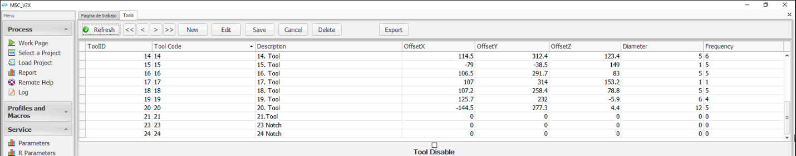
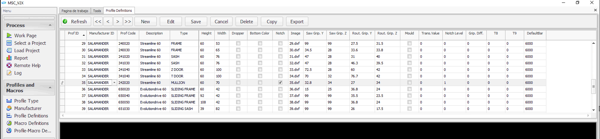
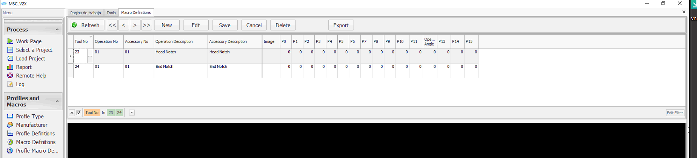
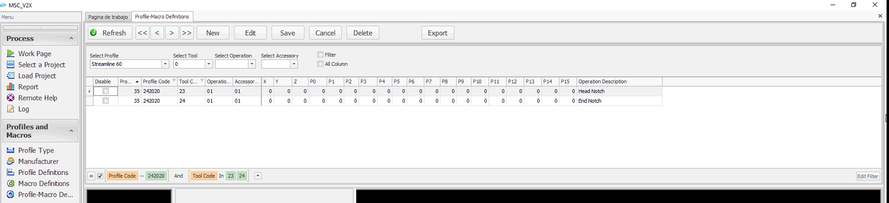
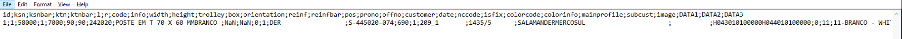

# KERTME

[English](endmilling_settings_en.md) · **[PDF indir](downloads/msc-endmilling-settings-tr.pdf)**

## PLC

**I.** Kertme ekseni yani `1K1` home yapılı bir eksendir.

**II.** Gerekli opsiyonlar aktif edilir.

_(* PLC → GV_Definitons.exp *)_

- `C_OPTION_END_MILLING` (* Makinede kertme opsiyonu *)
- `C_REVERSE_ENDMILLING` (* Kertme bıçağı ters *)
- `C_ENDMILLING_BLADE_COMPRESS_SENSOR` (* Kertme bıçak sıkıştırma sensor opsiyonu *)

## MSC

**I.** Kertme Pozisyonlaması için gerekli parametreler ayarlanmalıdır.  

  _(* Parametreler → Kesim İst. *)_
  
- `stKaliciData.PosLmtMin_1K1`
- `stKaliciData.PosLmtMax_1K1`
  - _(* 1K1 limitler kalıcıdatadan değişir, TSM programından limitler değiştirilemez. *)_
  - _(* Maks. limit pozisyonu Kertme İleri Sensörü görmeyecek şekilde ayarlanmalıdır. *)_
- `stKaliciData.fKertmeOffset`
  - _(* Profilin kertme pozisyonuna gelmesi için kullanılan offset değeri *)_
- `stKaliciData.fKertmeCenterPosition`
  - _(* Kertme bıçağının tablanın sıfır noktasından geçtiği pozisyon *)_
- `stKaliciData.fKertmeProfilGenislik`
  - _(* Kertme yapılacak profillerdeki maks. genişlik ölçüsü *)_
- `stKaliciData.fKertmeBicakCap`
  - _(* Kertmedeki büyük bıçağın çap ölçüsü *)_
- `stKaliciData.fKertmeTolerans`
  - _(* Kertme işleminden sonra bıçağın profilden kurtulma değeri *)_
- `stKaliciData.fKertmeMaxVelocity`
- `stKaliciData.fKertmeMidVelocity`
- `stKaliciData.fKertmeSlowVelocity`

**II.** `Tool23` ve `Tool24` takım sayfasında yok ise database eklenir. _(* Master → DBMaster.mdb *)_

**III.** Profil tanımlarında istenilen profil için **kertme sütunu** ve **kertme kademesi (0,1,2)** seçilir.

_(* Profiller ve Makrolar → Profil Tanımları *)_

**IV.** Kertme makroları tanımlanır. Parça başı için `Tool23`; parça sonu için `Tool24` seçilir.

_(* Profiller ve Makrolar → Makro Tanımları *)_

**V.** Kertme yapılacak profile işlenilecek kertme makroları tanımlanır.

_(* Profiller ve Makrolar → Profil-Makro Tanımları *)_

**VI.** İş dosyasında parça başı için `H043` parça sonu için `H044` kullanılmalıdır.

