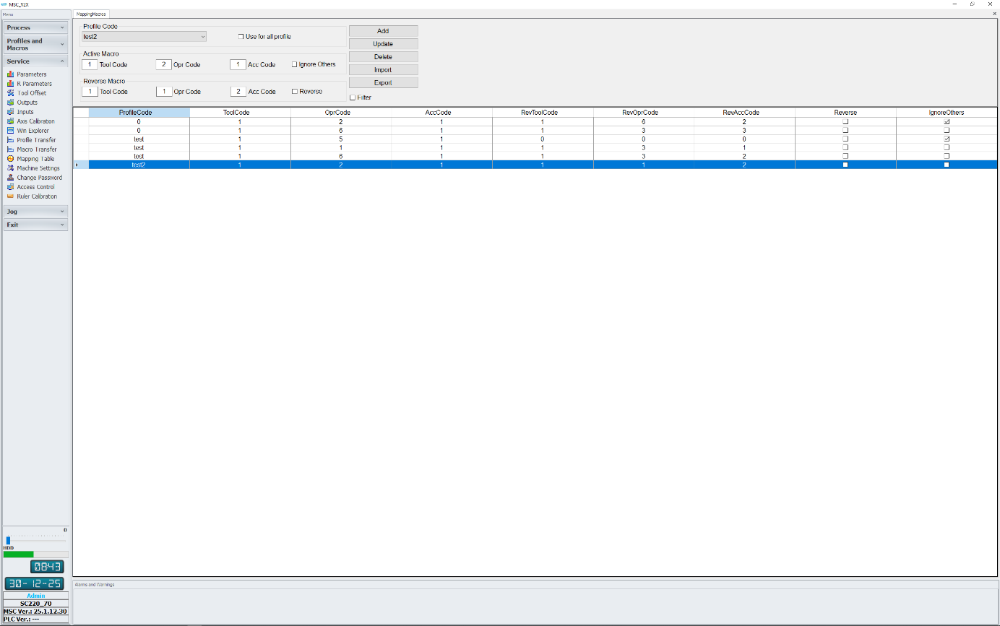
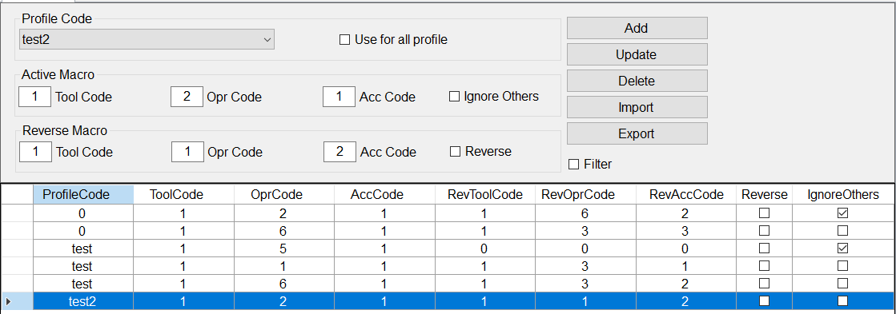
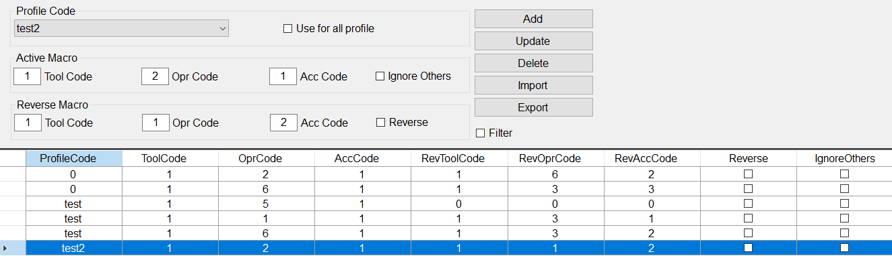
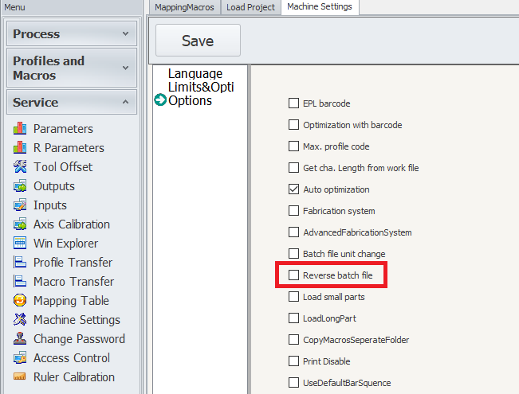
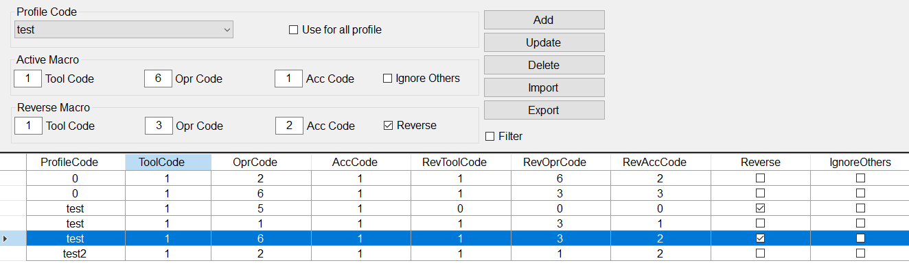
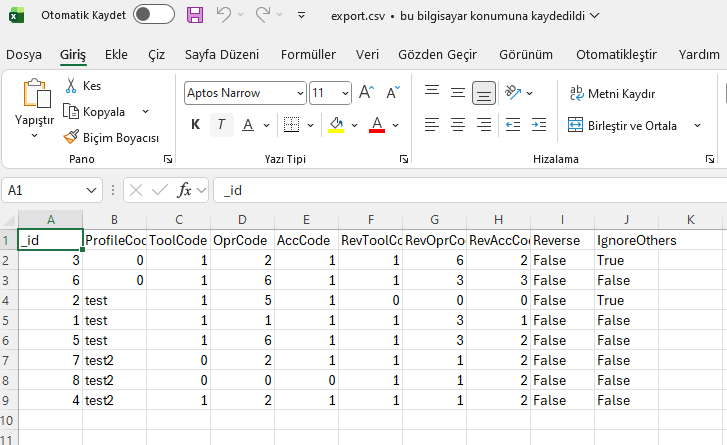

# EŞLEŞME TABLOSU (Mapping Table)

[English](macro_mapping_en.md) · **[PDF indir](downloads/msc-macro-mapping-tr.pdf)**

## MSC

**Tarih:** 30 Aralık 2025  
**Şirket:** HAFFNER MAKİNE  
**Yazar:** ERKAN BÜKER

---

## İçindekiler

1. [GİRİŞ](#1-giris)
2. [MENU KULLANIMI](#2-menu-kullanimi)
   - 2.1) [MAKRO EKLE](#21-makro-ekle)
   - 2.2) [MAKRO GÜNCELLEME](#22-makro-guncelleme)
   - 2.3) [MAKROYU SİL](#23-makroyu-sil)
   - 2.4) [İÇE AKTAR](#24-ice-aktar)
   - 2.5) [DIŞA AKTAR](#25-disa-aktar)
   - 2.6) [PROFİL SEÇİMİ](#26-profil-secimi)
   - 2.7) [EVRENSEL MAKRO EKLEME](#27-evrensel-makro-ekleme)
   - 2.8) [DİĞERLERİNİ YOK SAY MAKROSU EKLEME](#28-digerlerini-yok-say-makrosu-ekleme)
   - 2.9) [TERSLENECEK MAKRO EKLEME](#29-terslenecek-makro-ekleme)
   - 2.10) [AKTIF MAKRO TANIMI](#210-aktif-makro-tanimi)
   - 2.11) [TERSLENECEK MAKRO TANIMI](#211-terslenecek-makro-tanimi)
3. [KULLANIM](#3-kullanim)
   - 3.1) [YOKSAYILACAK MAKRO](#31-yoksayilacak-makro)
   - 3.2) [TEK MAKRO YOKSAYMA](#32-tek-makro-yoksayma)
   - 3.3) [TERSLENECEK MAKRO EKLEME](#33-terslenecek-makro-ekleme)
4. [İÇE/DIŞA AKTARIM](#4-icedisa-aktarim)

---

## 1) GİRİŞ

Birbirinden farklı makinelerde ortak iş dosyalarının okunması için bazı düzenlemeler gerekmektedir. Bu düzenlemelerin yapılması için eşleşme tablosuna ihtiyaç vardır. Eşleşme tablosu sayesinde birbirinden farklı makinelerde farklı tanımlanan makroların ilgili makine için doğru şekilde dönüştürülmesini sağlamaktadır. Bu sayede tek bir iş dosyası ile birbirinden farklı makinelerin çalıştırılması mümkün olmaktadır. Ek olarak aynı tip makinelerde farklı yönlü operasyonlarda farklı tip makrolar kullanılmaktadır. Bu da eşleşme tablosu sayesinde dönüşüme uğrayarak doğru doğrultudaki işlemi aktarmasını sağlamaktadır.

---

## 2) MENU KULLANIMI

Menüde bulunan nesnelerin açıklamaları aşağıdaki gibidir.

### 2.1) MAKRO EKLE

Makro eşlerinin tabloya eklenmesini sağlar. Makro bilgileri girilir ve ekle komutu ile istenen bilgiler tabloya eklenmesi sağlanır.

### 2.2) MAKRO GÜNCELLEME

Tabloda seçilen makronun üzerinde yapılan değişikliğinin güncellenmesini sağlar. Güncelleme için tablodan bir satır seçilmelidir. Seçim yapıldıktan sonra ilgili bilgiler menüdeki nesnelere aktarılır ve üzerinde değişiklik yapılırsa güncelleme komutu ile nesnelerdeki bilgiler tablodaki ilgili hücreleri günceller.

### 2.3) MAKROYU SİL

Tablodaki bir nesnenin silinmesini sağlar. İstenen satır seçilir ve komut çalıştırılarak silme gerçekleşir.

### 2.4) İÇE AKTAR

CSV (UTF-16 LE BOM, TAB ile ayrılmış.) dosyası ile tabloya yeni nesneler eklenmesi sağlanır.

### 2.5) DIŞA AKTAR

Tablodaki nesnelerin CSV uzantılı UTF-16 LE BOM formatında TAB ile ayrılmış bir dosyanın dışarı aktarılmasını sağlar.

### 2.6) PROFİL SEÇİMİ

Tabloya profile özgü bir makro eklemek istenirse ilgili profil seçimi buradan yapılır.

### 2.7) EVRENSEL MAKRO EKLEME

Global tanımlı bir makro eklenmek istenirse bu opsiyon seçilir. Bu opsiyon seçilirse profil kodu seçimi gizlenir. Profil kodu "0" olarak eklenir. Eşleşme sırasında profil kodu fark etmeksizin tüm profillere eşleşmeler uygulanır. Eşleşmede öncelik profil kodudur. Profil kodu olan eşleşmelerde öncelik profil koduna ait olan eşleşmeyi yapmaktır. Profil koduna ait olan eşleşme yoksa global eşleşme kontrol edilir.

### 2.8) DİĞERLERİNİ YOK SAY MAKROSU EKLEME

Bu seçenek makroların seçimler dışında olanlarını yok saymayı sağlamak için tasarlanmıştır. Burada ilgili profil koduna sahip veya global tanımlı makrolar dışında herhangi bir makro tanımı yapılmaz. Yok say seçeneği varsa yok say seçimi olmayan eşleşmeler dikkate alınmaz.

### 2.9) TERSLENECEK MAKRO EKLEME

Bu seçenekte makro eşleşmeleri sadece terslenen iş dosyasında kullanılmaktadır. Proje yüklenmesi sırasında bu eşleşmeler kullanılmamaktadır. Tersleme sırasında tüm makrolarda X konumu parça boyuna göre değiştirilir.

### 2.10) AKTIF MAKRO TANIMI

İlgili alanda dönüşüm yapılacak olan makro bilgilerinin girildiği bir alandır.

### 2.11) TERSLENECEK MAKRO TANIMI

İlgili alanda dönüşüm yapılacak makronun hangi makroya dönüşüm yapacağının bilgilerinin girildiği alandır. Bu alandaki bilgiler "0" girilirse eşleşme sırasında ilgili aktif makro yükleme sırasında silinir.

---

## 3) KULLANIM

### 3.1) YOKSAYILACAK MAKRO

Tablodaki tanımlara göre aşağıda bazı örneklemeler mevcuttur.

#### Örnek Tablo 1: Evrensel Yok Sayma ile Makro

| GİRİŞ (Input) | PROFİL (Profile) | SONUÇ (Result) |
|---------------|------------------|----------------|
| H01020100000 | H01010600000 | test | H01060200000 |
| H01050100000 | H01030300000 | test |  |
| H01010100000 | H01010600000 | test2 |  |
| H01020100000 | H01060100000 | test2 | H01060200000 |
| H01020100000 | H01030600000 | test3 | H01060200000 |

**Açıklama:**  
Tabloda evrensel yok sayma içeren makrolar olduğu için girişteki tüm makrolar kontrolden geçip tabloya uymayan makrolar yok sayılır. Bu nedenle yukarıdaki tabloda eşleşen makrolar olmasına rağmen yok sayma öncelikli olduğu için sistem sadece diğerlerini yok say seçili olan makroları eşliyor. Harici olanları siliyor. Profil bazlı yok sayma olduğu zaman ilk önce profil içi diğerlerini yok say özellikli makrolar kontrol edilir. Ardından evrensel olanlar kontrol edilir.

---

### 3.2) TEK MAKRO YOKSAYMA

Tablodaki tanımlara göre aşağıda bazı örneklemeler mevcuttur.

#### Örnek Tablo 2: Tek Makro Yok Sayma

| GİRİŞ (Input) | PROFİL (Profile) | SONUÇ (Result) |
|---------------|------------------|----------------|
| H01020100000H01010600000 | test | H01060200000|
| H01050100000H01030300000 | test | |
| H01010100000H01010600000 | test2 | |
| H01020100000H01060100000 | test2 | H01060200000 |
| H01020100000H01030600000 | test3 | H01060200000 |

**Açıklama:**  
Tabloda yok sayma olmadığı için herhangi bir makro silme olmaz. Makroların özel olarak yok sayılması için terslenen makro tanımında takım kodunun "0" girilmesidir. Bu tanıma uyan tek makro içeriği "test" profiline ait makro tanımlarında olduğu için sadece ona ait bir eşleşmede makro silinmiştir.

---

### 3.3) TERSLENECEK MAKRO EKLEME

Bu opsiyon seçili olan makroların aktif olarak kullanımı için makine ayarlarından "Reverse Batch File" opsiyonunun aktif olması gerekmektedir. Bu opsiyon kapalı konumda olduğu zaman ilgili dönüşüm kullanılmaz.

#### Örnek Tablo 3a: "Reverse Batch File" Opsiyonu KAPALI İken

| GİRİŞ (Input) | PROFİL (Profile) | SONUÇ (Result) |
|---------------|------------------|----------------|
| H01020100000H01010600000 | test | H01060200000H01010600000 |
| H01050100000H01030300000 | test | H01050100000H01030300000 |
| H01060100000H01010600000 | test2 | H01060100000H01010600000 |
| H01020100000H01060100000 | test2 | H01010200000H01030300000 |
| H01020100000H01030600000 | test3 | H01060200000H01030600000 |

#### Örnek Tablo 3b: "Reverse Batch File" Opsiyonu AÇIK İken

| GİRİŞ (Input) | PROFİL (Profile) | SONUÇ (Result) |
|---------------|------------------|----------------|
| H01020100000H01060100000 | test | H01060205000H01030205000 |
| H01050100000H01030300000 | test | H01030305000 |
| H01060100000H01010600000 | test2 | H01060105000H01010605000 |
| H01020100000H01060100000 | test2 | H01010205000H01030305000 |
| H01020100000H01030600000 | test3 | H01060205000H01030605000 |

**Açıklama:**  
Makine ayarlarında opsiyon açık ise tabloda eşleşenler değişime uğrar ardından eşleşme tablosu terslemek için devreye girer. Aynı sırada x pozisyonu parça boyuna göre terslenir. Örnek tablolarda parça boyu 500 birim olarak alınmıştır.

---

## 4) İÇE/DIŞA AKTARIM

Tabloyu excel ortamında veya herhangi bir yazı editörü kullanarak doldurmak isterseniz kolaylıkla dışa aktar butonu ile örnek bir format elde edebilirsiniz.

### Dosya Formatı

**İçe/Dışa Aktarma Formatı:** CSV (UTF-16 LE BOM, TAB ile ayrılmış)

---

## Teknik Özet

### Doküman Amacı

Bu kılavuz, Haffner Makine'nin MSC makineleri için Eşleşme Tablosu (Mapping Table) sistemini açıklamaktadır. Sistem şunları sağlar:

- Farklı makineler arasında makro tanımlarının dönüştürülmesi
- Tek bir iş dosyasının birden fazla makinede kullanılması
- Farklı yönlü operasyonlar için farklı makro tiplerinin işlenmesi
- Profile dayalı ve evrensel makro yönetimi
- Toplu işlemler için içe/dışa aktarma fonksiyonelliği

### Ana Özellikler

1. **Profile Dayalı Eşleştirme:** Makineye özgü makro dönüşümlerine izin verir
2. **Evrensel Makrolar:** Tüm profillerde geçerli olan global tanımlar
3. **Yok Sayma Fonksiyonu:** Yok sayma kuralları ile seçici makro işleme
4. **Ters Makrolar:** X-pozisyon dönüşümü ile terslenmiş iş dosyaları için özel işlem
5. **İçe/Dışa Aktarma:** CSV UTF-16 LE BOM format desteği

### İş Akışı Öncelikleri

1. Profile özgü eşleştirmeler öncelik kazanır
2. Profil eşleştirmesi yoksa evrensel (global) eşleştirmeler kontrol edilir
3. Yok sayma kuralları aktif olduğunda en yüksek önceliğe sahiptir
4. Ters makro fonksiyonelliği için reverse batch file opsiyonu etkin olmalıdır

---

## Görsel Dizini

Bu dokümanda kullanılan tüm görseller `_media/macro_mapping/` klasöründe bulunmaktadır:

- `1-giris-eslesme-tablosu.png` - Giriş bölümü ekran görüntüsü
- `2-menu-kullanimi.png` - Menü kullanımı arayüzü
- `3-1-yoksayilacak-makro.png` - Yoksayılacak makro örneği
- `3-2-tek-makro-yoksayma.png` - Tek makro yoksayma tablosu
- `3-3-terslenecek-makro-ayarlari.png` - Terslenecek makro ayarları ekranı
- `3-3-terslenecek-makro.png` - Terslenecek makro örnek tablosu
- `4-ice-disa-aktarim.png` - İçe/Dışa aktarım ekranı

Toplam **7 görsel** kullanılmıştır (19 görsel PDF'den çıkarılmış, ilgili olanlar seçilmiştir).
